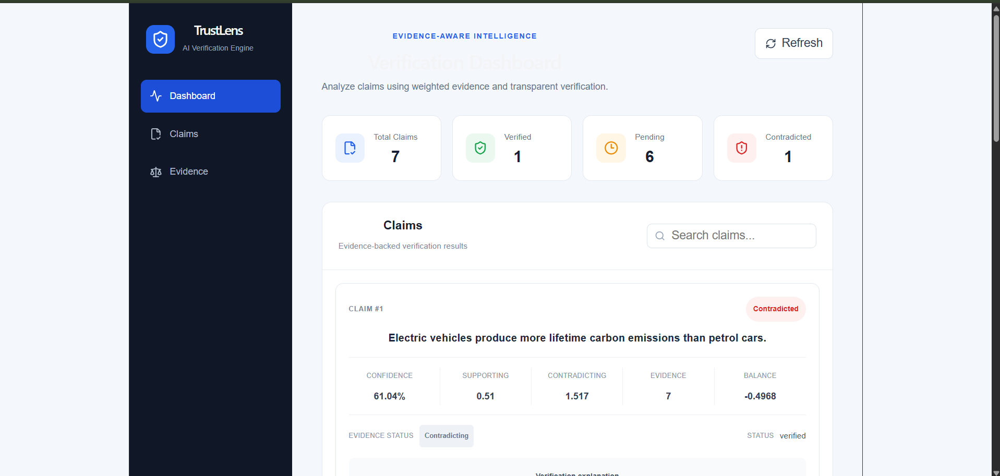
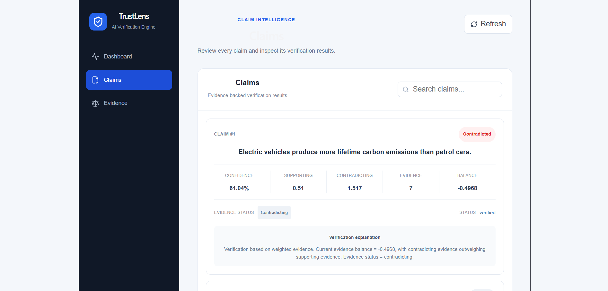
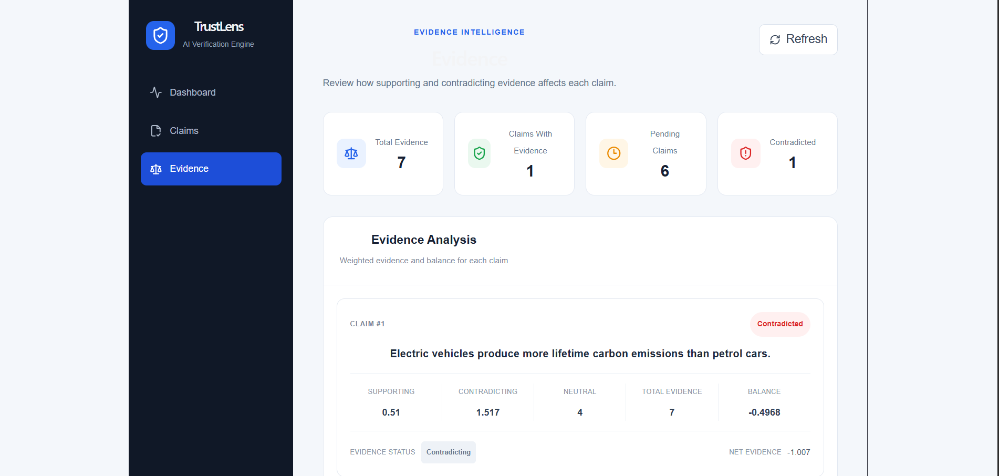
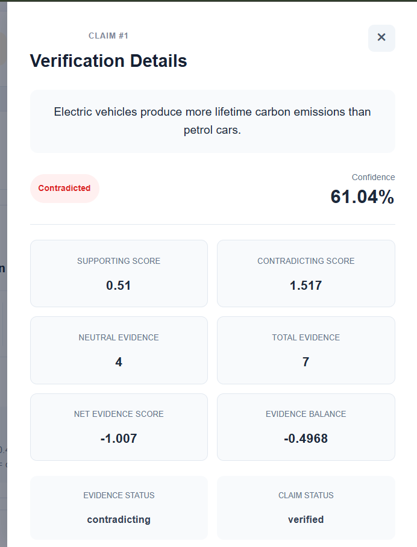
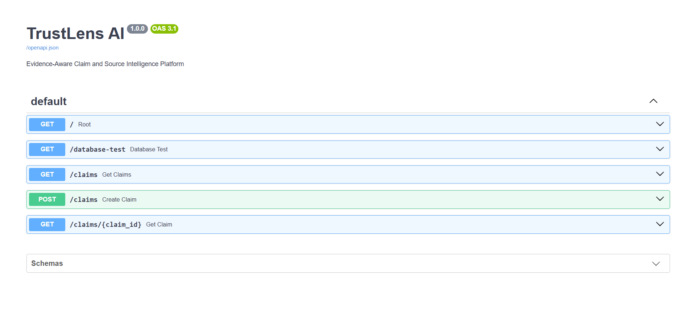
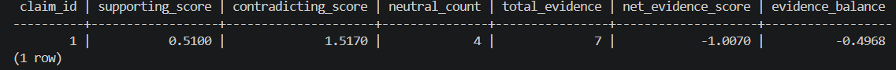

# TrustLens AI 

**Evidence-Aware Claim Verification Platform**

TrustLens AI is a web application that helps analyze claims using the evidence available for them. Instead of showing only whether a claim is verified or contradicted, the system also shows how much supporting and contradicting evidence was found.

The main idea behind the project is to make claim verification easier to understand by showing the scores and reasoning behind the final result.

---

## What does TrustLens do?

TrustLens takes a claim and analyzes the evidence associated with it.

It keeps track of:

* Supporting evidence
* Contradicting evidence
* Neutral evidence
* Total evidence
* Supporting score
* Contradicting score
* Net evidence score
* Evidence balance
* Confidence score

The results are then displayed through a simple web dashboard.

---

## Main Features

### Claim Management

Claims can be added and retrieved through the backend API.

For example:

> The Earth revolves around the Sun.

Each claim receives its own ID and is stored in the database.

### Evidence Analysis

The system separates evidence into three categories:

* Supporting
* Contradicting
* Neutral

The supporting and contradicting evidence are given weights and used to calculate the overall evidence balance.

### Verification Results

For every claim with available evidence, TrustLens displays the calculated result along with the numbers behind it.

This makes it possible to see **why** a claim received its result instead of only seeing a final label.

### Dashboard

The frontend contains three main sections:

* Dashboard
* Claims
* Evidence

There is also a detailed verification view for individual claims.

---

## How it works

The basic flow of the application is:

Claim
  ↓
Evidence
  ↓
Evidence Classification
  ↓
Weighted Evidence Scores
  ↓
Evidence Balance
  ↓
Verification Result
  ↓
Confidence + Explanation

The net evidence score is calculated using:

Net Evidence Score =
Supporting Score - Contradicting Score

A negative result means the contradicting evidence has a higher weighted score, while a positive result means the supporting evidence has a higher weighted score.

---

## Example

One of the claims currently stored in the project is:

> **Electric vehicles produce more lifetime carbon emissions than petrol cars.**

The system produced the following values:

| Metric              |         Value |
| ------------------- | ------------: |
| Supporting Score    |        0.5100 |
| Contradicting Score |        1.5170 |
| Neutral Evidence    |             4 |
| Total Evidence      |             7 |
| Net Evidence Score  |       -1.0070 |
| Evidence Balance    |       -0.4968 |
| Confidence          |        61.04% |
| Evidence Status     | Contradicting |

The dashboard shows this result along with an explanation of the evidence balance.

---

## Dashboard

The dashboard gives an overview of the claims currently stored in the system.

It shows:

* Total Claims
* Verified Claims
* Pending Claims
* Contradicted Claims

It also displays individual claim cards with their evidence and verification information.

---

## Claims Page

The Claims page is used to view individual claims and their verification results.

For each claim, the application shows information such as:

* Claim text
* Verdict
* Confidence
* Supporting score
* Contradicting score
* Total evidence
* Evidence balance
* Verification explanation

---

## Evidence Page

The Evidence page provides a separate view of the evidence analysis.

It shows:

* Total Evidence
* Claims With Evidence
* Pending Claims
* Contradicted Claims
* Supporting score
* Contradicting score
* Neutral evidence
* Total evidence
* Evidence balance

---

## Technology Used

### Frontend

* React
* Vite
* JavaScript
* CSS

### Backend

* Python
* FastAPI
* Uvicorn

### Database

* PostgreSQL

### API Documentation

* Swagger UI
* OpenAPI

### Development Tools

* VS Code
* Git
* GitHub
* Python Virtual Environment

---

## Project Structure

Project_2/
│
├── backend/
│   └── app/
│       ├── main.py
│       ├── database.py
│       ├── search.py
│       ├── init.py
│       ├── test_ingestion.py
│       └── test_search.py
│
├── frontend/
├── src/
├── .env
├── .gitignore
└── requirements.txt

---

## API Endpoints

The FastAPI backend currently provides the following endpoints:

| Method | Endpoint             | Description                          |
| ------ | -------------------- | ------------------------------------ |
| GET    | `/`                  | Check whether the backend is running |
| GET    | `/database-test`     | Check the database connection        |
| GET    | `/claims`            | Get all claims                       |
| POST   | `/claims`            | Create a new claim                   |
| GET    | `/claims/{claim_id}` | Get a specific claim                 |

Swagger documentation is available at:

http://127.0.0.1:8000/docs

---

## Example API Request

### Create a Claim

POST /claims

Request:

{
  "claim_text": "The Earth revolves around the Sun."
}

Example response:

{
  "message": "Claim stored successfully",
  "claim_id": 7,
  "claim_text": "The Earth revolves around the Sun."
}

---

## Database

PostgreSQL is used to store the claims and the related verification information.

For example, the evidence calculation for Claim 1 produced:

claim_id              1
supporting_score      0.5100
contradicting_score   1.5170
neutral_count         4
total_evidence        7
net_evidence_score   -1.0070
evidence_balance     -0.4968

These values are also reflected in the TrustLens dashboard.

---

## Running the Project

### 1. Start the Backend

Activate the virtual environment:

in powershell:
.\venv\Scripts\Activate.ps1

Go to the backend folder:
in powershell:
cd backend

Start the FastAPI server:

in powershell:
uvicorn app.main:app --reload --app-dir .

The backend runs at:

http://127.0.0.1:8000
---

### 2. Start the Frontend

Open another terminal and go to the frontend folder:
in powershell:
cd frontend

Install the required packages:

in powershell:
npm install

Start the frontend:

in powershell:
npm run dev

Then open the local URL shown by Vite, usually:

http://localhost:5173

---

## Testing

The backend was tested using the Swagger interface as well as the PostgreSQL database.

The following were tested successfully:

* Backend health check
* Database connection
* Getting all claims
* Getting an individual claim
* Creating a new claim
* Evidence score calculation
* Verification result display
* Frontend dashboard
* Claims page
* Evidence page
* Verification details

---

## Screenshots

### Dashboard

### Claims

### Evidence

### Verification Result

### Swagger API

### PostgreSQL Evidence Ranking

---

## Future Improvements

Some things I would like to add later are:

* Automatic collection of evidence from online sources
* Source credibility scoring
* Better semantic matching between claims and evidence
* Evidence summaries
* Source links and citations
* User login and authentication
* Claim history
* Cloud deployment
* More detailed analytics

---

## Conclusion

TrustLens AI was built to make claim verification more transparent.

The main focus of the project is not just producing a verification result, but also showing the evidence scores and calculations behind that result. The project combines a React frontend, FastAPI backend, and PostgreSQL database into one working application.

---

Project: TrustLens AI
Type: Full-Stack AI / Evidence Analysis Project
Backend: FastAPI
Frontend: React + Vite
Database: PostgreSQL
